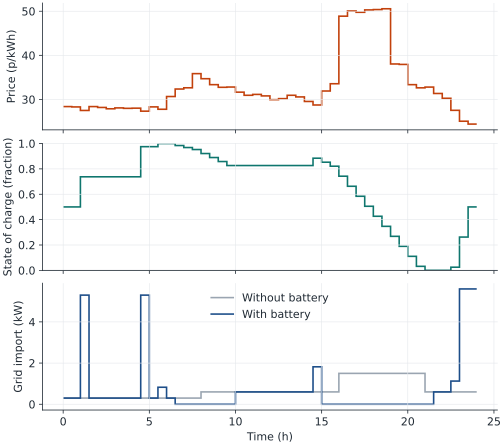
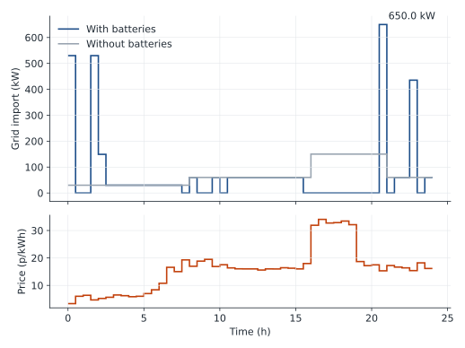

# fleet-sim

A simulator of UK home batteries scheduled against half-hourly electricity prices (Octopus Agile), scaling from one home to a fleet, to study how fleets of individually optimal batteries create new demand peaks and how coordination strategies trade savings against peak reduction.

## Quickstart

```bash
uv sync
uv run pytest
uv run mypy --strict src
uv run ruff check
uv run ruff format
```

## One home

```bash
uv run fleet-sim run-home --date 2026-10-20 --region C
```

`home.toml` holds the battery and the half-hourly demand. The command fetches that day's Agile import prices, runs the cheapest-slot rule and the optimiser, prints both bills against the no-battery bill, and writes `figures/day.svg` and `figures/day.png`.

For 20 October 2026 in region C the bills were 604.05 pence with no battery, 506.05 pence with the rule (`n = 8`), and 480.78 pence with the optimiser. The rule kept 0.795 of the optimal saving. The figure below is that run, written with `--output docs/day`.



## A fleet

```bash
uv run fleet-sim run-fleet --homes 100 --start 2026-01-01 --end 2026-01-31 --region C
```

The command builds 100 copies of `home.toml`, solves each day on its own, and prints the median, minimum, and maximum of the fleet measures. It writes `frames.json`, plus `figures/herding` and `figures/peaks` as SVG and PNG.

For January 2026 in region C the median peak was 560.00 kW with the batteries and 150.00 kW without them. Without batteries that peak is the evening demand of the hundred homes, and it does not change from day to day. Charging lifts it: the highest peak was 650.00 kW, on 2 January. The median saving was 97.16 pence per home. The figure below is that day's import and price, written with `--herding docs/herding --peaks docs/peaks`.


