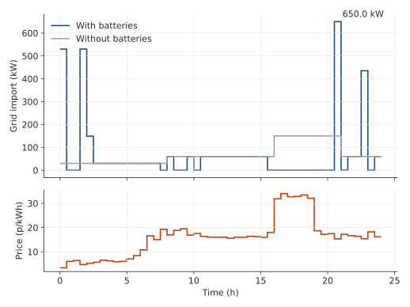
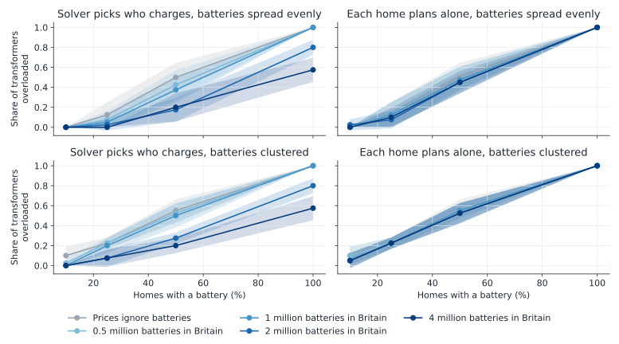

# fleet-sim

A simulator of UK home batteries scheduled against half-hourly electricity prices (Octopus Agile). It grows from one home to a fleet, to study how batteries that each do the best for their own home can together create new peaks in demand, and what coordinating them would trade away in savings to remove those peaks.

## The story so far

A home battery on a half-hourly tariff makes money in a simple way: it fills up in the middle of the night, when electricity is cheap, and runs the house through the early evening, when it is dear. On one October day in London that turns a £6.04 bill into £4.81. A battery doesn't need to be clever to earn this. A rule as crude as "charge in the cheapest eight half-hours" gets four-fifths of the way to the best possible schedule.

The trouble starts when every home does it. A hundred homes with the same battery all find the same cheapest half-hours and charge in them together. Without batteries the group's busiest moment is the evening, at 150 kW. With batteries it moves to whichever half-hours are cheapest, late in the evening or in the night, and nearly quadruples, to 560 kW. The fleet has created a peak that didn't exist before. That is the herd.

Perhaps that is an artefact of identical homes. Real homes differ in what they use and when, and in the batteries they buy, and that variety does soften the herd: a varied fleet of eight homes peaks 3.6 kW lower than eight copies of the average home. But not by enough. A single battery among eight homes is already enough to lift the group's peak above where it was without any.

A new peak matters most on the street. Each group of streets hangs off one transformer, sized for an ordinary evening at about 2 kW a home, on the reasonable assumption that homes don't all boil the kettle at once. Batteries break that assumption. Across fifty simulated homes on four transformers, none is overloaded without batteries. With batteries in half the homes, more than half the transformers are. With batteries in every home, every transformer is. Where batteries cluster, as they do when one street adopts them before its neighbours, the trouble starts sooner.

So far, though, every battery has treated the price as fixed. A herd of millions would not leave it fixed: crowding into the cheapest half-hour makes it dearer. To see how much, the wholesale price is fitted against how much demand is left after wind and solar, using four years of market history. Where batteries charge, each extra gigawatt adds roughly half a penny per kilowatt-hour. The curve is steeper there than where batteries discharge, so a growing fleet should push its buying price up faster than it pushes its selling price down.

Letting the price respond answers the obvious hope that the market will break up the herd by itself. Nationally, it partly does. As millions of batteries make their favourite half-hours dearer, charging spreads into the hours around them, and each home keeps most of its saving: 80% at 4 million batteries under the main price curve. That depends on how steeply the evening price responds, which history pins down poorly, and steeper curves leave as little as a quarter. Locally, it doesn't break up the herd. The price settles how much the whole country charges in each half-hour, not which homes do it. Left to plan alone, neighbours look at the same prices, do the same arithmetic, and charge together again. Every transformer on a street full of batteries stays overloaded, however many batteries Britain has.

A national price can't see a street. Something that can is the subject of the next milestone: coordinating the batteries themselves.

The sections below tell each step in more detail, with the command that produced it. They use different setups, because each step was built on the one before. One home is shown on one October day. The other steps use January 2026: first a hundred identical homes, then eight real ones, then fifty real ones wired to transformers. So a number in one section isn't directly comparable with a number in another.

## Quickstart

```bash
uv sync
uv run pytest
uv run mypy --strict src
uv run ruff check
uv run ruff format
```

## One home

```bash
uv run fleet-sim run-home --date 2026-10-20 --region C
```

Start with a single home in London (Agile region C), with a 10 kWh battery that charges and discharges at up to 5 kW, and a typical day's demand written in `home.toml`. The command fetches that day's Agile prices and schedules the battery two ways. The first is a rule: charge in the cheapest eight half-hours and discharge in the dearest eight. The second is an optimiser, which finds the cheapest possible schedule given the battery's size, speed and losses. It prints both bills next to the bill without a battery and draws the day.

On 20 October 2026 the bill without a battery was 604.05 p. The rule brought it down to 506.05 p and the optimiser to 480.78 p. So the rule kept 0.795 of the best possible saving, which is most of it, for almost no thought. In the figure the battery fills in the cheaper hours after midnight and empties through the dear early evening, so the home imports nothing from the grid while electricity is dearest. The figure was written with `--output docs/day`.


One battery is a good deal for its owner. The next question is what happens when its neighbours have one too.

## A fleet of identical homes

```bash
uv run fleet-sim run-fleet --homes 100 --start 2026-01-01 --end 2026-01-31 --region C
```

The simplest fleet is a hundred copies of that same home, each solved on its own against the same prices, every day of January 2026. The command prints the median, smallest and largest of each fleet measure across the month, and writes `frames.json` and two figures.

Without batteries, the hundred homes peak at 150.00 kW, their evening demand, the same every day. With batteries, the median daily peak is 560.00 kW, and the highest, on 2 January, is 650.00 kW. Every battery is doing the best thing for its own home, and the median saving is 97.16 p per home per day. But because they all see the same prices, they all choose the same half-hours. The figure shows 2 January. The grey line is the fleet without batteries, the blue line is with them, and the price is in the panel below. Through the dear early evening the batteries run every home, and the fleet draws nothing from the grid. The moment the price falls, at 20:30, all hundred batteries start refilling at once, and the fleet draws 650 kW, more than four times its old evening peak. The same thing happens at the cheap half-hours after midnight. It was written with `--herding docs/herding --peaks docs/peaks`.



A hundred identical homes is the worst case for herding. Real streets aren't like that.

## Real homes are varied

```bash
uv run fleet-sim run-scenario scenarios/diverse.toml
```

Real households differ, so here each home's demand is drawn from the Low Carbon London trial, which recorded real London homes half-hour by half-hour. Each home gets a battery drawn from a catalogue of real products, from 5 kWh to 13.5 kWh, with slightly different efficiencies. The fleet is eight homes, over 5–11 January 2026, drawn afresh thirty times. Numbers are the average of the thirty, with a 95% range in brackets: if the whole experiment were repeated with fresh draws, the average would very likely land in that range. The command reads the households from `.cache/lcl`, prints every measure with its range, and writes its frames and figures under `scenario-out/`.

Variety helps. With a battery in every home, the varied fleet peaks 3.57 kW lower than eight identical copies of the average home (−4.34 to −2.80 kW). Different demands and different batteries pull the homes' schedules slightly apart.

It doesn't help much, though. The figure sweeps the share of homes with a battery, using the six levels in `scenarios/penetration-sweep.toml`. Without batteries the eight homes peak at about 11 kW. A single battery among the eight is already enough to lift the peak above that, and with a battery in every home the peak is 26.19 kW higher. Batteries responding to the same prices line up, and that outweighs the variety between homes.


A bigger peak only matters if something has to carry it. The first thing that has to carry it is the street's transformer.

## Transformer overloads

```bash
uv run fleet-sim run-scenario scenarios/network-sweep.toml
```

A local transformer, the substation feeding a group of streets, isn't sized for every home drawing its maximum at once. It is sized for the most a typical home draws when its neighbours' peaks are averaged in. Engineers call this ADMD, after diversity maximum demand, and take it as about 2 kW a home. That works because ordinary homes don't all boil the kettle at the same moment. Here fifty real homes are wired to four transformers, each sized that way: 2 kW a home, a power factor of 0.95, rounded up to a standard rating. The week is 5–11 January 2026, with thirty fresh draws.

Without batteries no transformer is overloaded. On average each runs at 0.43 of its rating at its busiest. Add batteries and they charge together in the same cheap half-hours. With batteries in a quarter of the homes, 15% of transformers are overloaded. With batteries in half, more than half are. With batteries in every home, every transformer is overloaded, running on average at 1.66 times its rating at its busiest.

Clustering makes it worse sooner. Batteries rarely spread evenly; one street adopts them before the next. When battery homes bunch on a few transformers, the energy those transformers carry above their rating rises from 3 kWh to 70 kWh at a quarter of homes. The full results are in [docs/results/milestone-4.md](docs/results/milestone-4.md).


Everything so far has assumed the price stays put however many batteries chase it. A herd of millions wouldn't leave it alone. To see how far it would move it, the next step measures how the price responds to load.

## How the price responds to load

```bash
uv run python scripts/fit_price_curves.py compare
uv run python scripts/fit_price_curves.py finalise
```

The wholesale price in any half-hour is set mostly by how much demand is left once wind and solar have been used, called the residual load. More residual load means dearer power stations have to run, so the price rises. Batteries that all charge in the same half-hours add to the residual load there, and so raise the price. To model that, the price is fitted as a curve of residual load. `compare` fits five curve shapes to three measures of the price on 2021–2024, scoring each on a year it didn't see. `finalise` refits the chosen curves, scores them once on 2025, and writes `calibration/price_curves.json`, which the later steps read.

One adjustment makes the history fit. Prices in 2022 sat far above other years because gas was expensive, not because demand was higher. So the main curve first divides the price by the fuel cost of a gas power station, and then the four years fall on one curve. That curve is exponential: it fits as well as any smooth shape, and it can never say that more load makes power cheaper. On 2025, a year it didn't see, it misses the price by 21.3 £/MWh on average (root-mean-square), against 19–36 £/MWh on the years it was fitted to. Why this curve was chosen, and the two kept as a check, are explained in [ADR-0004](docs/decisions/0004-price-curve-model.md).

Where the fleet charges, one extra gigawatt of load raises the wholesale price by about £4–6/MWh, or 0.4–0.6 p/kWh, more in years when gas is dear. The curve is steeper where the fleet charges than where it discharges, so a growing fleet should raise its buying price faster than it lowers its selling price. Two other curve shapes, a quadratic and a cubic, fit history two to three times worse. But they say the evening price is two to six times more sensitive to load, so they are kept as an upper bracket on how hard batteries could push the evening price around. The numbers are in [docs/results/price-curves.md](docs/results/price-curves.md).


With a curve for how the price responds, the herd can finally be put back into the market it is herding in.

## The fleet in the loop

```bash
uv run fleet-sim run-scenario scenarios/market-sweep.toml --release
```

One battery is far too small to move the electricity price. A million of them are not. Here the price responds to the fleet through the curve above, and each day is solved for the point where it settles: every home's schedule is the best it can do at the prices the whole fleet creates. The same fifty homes and four transformers, in the same January week, are scaled up to stand for 0.5 to 4 million batteries in Great Britain.

The first thing a responsive price does is spread the herd, but only partly. With prices that ignore it, the fleet piles into the same half-hours, the tall grey spikes in the figure below. As batteries move the price, the spikes shrink and charging spreads into the half-hours on either side. At half a million batteries the change is small. At 4 million, each battery adds about half as much to the busiest half-hour as it would if prices ignored the fleet. The total still grows: 4 million batteries add about 8.8 GW at their peak, roughly a third of Britain's overnight demand that week. The evening doesn't move, because each battery is already running its whole home then.


Spreading costs each home some of its saving, and how much depends on the price curve. With prices that ignore it, a battery saves its home 79 p a day, about £290 a year at that rate. That is less than the 97 p of the identical homes above, which had a different household, a different battery and the whole of January. Under the main price curve a home keeps 90% of that saving at 1 million batteries and 80% at 4 million. Under the two steeper curves, the upper bracket, it keeps only 42% and 25% at 4 million. Beyond about 1 million batteries, how sharply the evening price responds is the biggest uncertainty in the answer.


The street is a different matter. The price settles how much the fleet charges in each half-hour, not which homes do it. If the solver hands out the schedules, it happens to spread streets apart, and more batteries nationally seem to relieve local transformers (left). But nothing makes a home follow that schedule rather than another one that costs the same. When each home plans alone at the same prices, neighbours make the same choice and herd again (right). Every transformer on a fully battery-equipped street stays overloaded, however many batteries Britain has.



The full results, what depends on the price curve, and how far to trust the numbers are in [docs/results/milestone-4.6.md](docs/results/milestone-4.6.md).

A national price can't see a street. Protecting transformers needs a signal that can, which is the question for milestone 5: coordinating the batteries, and what that costs their owners.
