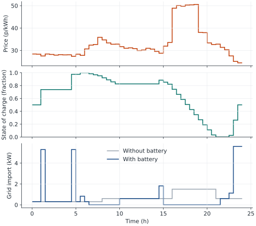
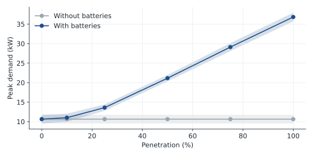
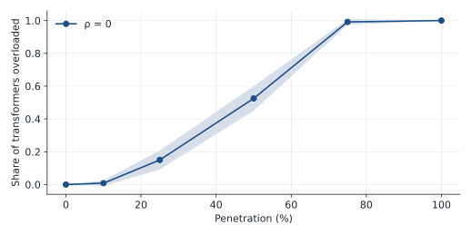
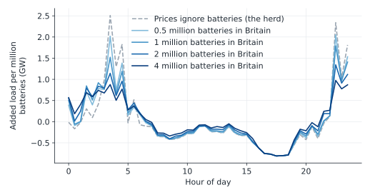
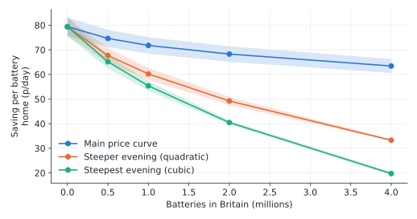

# fleet-sim

A simulator of UK home batteries scheduled against half-hourly electricity prices (Octopus Agile), scaling from one home to a fleet, to study how fleets of individually optimal batteries create new demand peaks and how coordination strategies trade savings against peak reduction.

## Quickstart

```bash
uv sync
uv run pytest
uv run mypy --strict src
uv run ruff check
uv run ruff format
```

## One home

```bash
uv run fleet-sim run-home --date 2026-10-20 --region C
```

`home.toml` holds the battery and the half-hourly demand. The command fetches that day's Agile import prices, runs the cheapest-slot rule and the optimiser, prints both bills against the no-battery bill, and writes `figures/day.svg` and `figures/day.png`.

For 20 October 2026 in region C the bills were 604.05 pence with no battery, 506.05 pence with the rule (`n = 8`), and 480.78 pence with the optimiser. The rule kept 0.795 of the optimal saving. The figure below is that run, written with `--output docs/day`.



## A fleet

```bash
uv run fleet-sim run-fleet --homes 100 --start 2026-01-01 --end 2026-01-31 --region C
```

The command builds 100 copies of `home.toml`, solves each day on its own, and prints the median, minimum, and maximum of the fleet measures. It writes `frames.json`, plus `figures/herding` and `figures/peaks` as SVG and PNG.

For January 2026 in region C the median peak was 560.00 kW with the batteries and 150.00 kW without them. Without batteries that peak is the evening demand of the hundred homes, and it does not change from day to day. Charging lifts it: the highest peak was 650.00 kW, on 2 January. The median saving was 97.16 pence per home. The figure below is that day's import and price, written with `--herding docs/herding --peaks docs/peaks`.


## Findings

```bash
uv run fleet-sim run-scenario scenarios/diverse.toml
```

The command reads the scenario, draws each replication from the Low Carbon London file in `.cache/lcl`, and prints every metric as a mean with a 95% interval. It writes frames and metadata under `scenario-out/`, and saves the diversity and penetration figures there.

Eight homes, region C, 5–11 January 2026, thirty replications. Demand is the first 100 households in that file. A diverse fleet peaks 3.57 kW below identical copies of the same mean home (95% interval −4.34 to −2.80 kW). One battery in the eight is enough for the fleet peak to rise above the no-battery peak, and at full penetration the peak is 26.19 kW higher. The curve is the six penetrations in `scenarios/penetration-sweep.toml`.



### Transformer overloads

```bash
uv run fleet-sim run-scenario scenarios/network-sweep.toml
```

Fifty homes on four transformers, region C, 5–11 January 2026, thirty replications. Each transformer is sized from ADMD (2 kW per home, power factor 0.95, standard ratings). Without batteries, no transformer is overloaded (mean utilisation 0.43). Batteries charging during the same cheap half-hours push transformers past their limits: at 25% penetration, 15% of transformers are overloaded; at 50%, more than half; at 100%, every transformer is overloaded with a mean peak utilisation of 1.66. When battery ownership clusters on transformers (ρ = 0.8), overloads appear earlier and hit harder — at 25% penetration, overload energy rises from 3 kWh to 70 kWh. The full results are in [docs/results/milestone-4.md](docs/results/milestone-4.md).



### The fleet in the loop

```bash
uv run fleet-sim run-scenario scenarios/market-sweep.toml --release
```

One battery is far too small to move the electricity price. A million of them are not. When they all charge in the same cheap half-hour, that half-hour stops being cheap. Here the price responds to the fleet through a curve fitted to 2021–2024 market history. Each day is solved for the point where it settles: every home's schedule is the best it can do at the prices the whole fleet creates. The same fifty homes and four transformers as above, in the same January week, are scaled up to 0.5–4 million batteries in Great Britain.

**A responsive price spreads the herd, but only partly.** With prices that ignore it, the fleet piles into the same half-hours, the tall grey spikes below. As batteries move the price, the spikes shrink and charging spreads into neighbouring half-hours. At half a million batteries the change is small. At 4 million, each battery adds about half as much to the busiest half-hour as it would if prices ignored the fleet. The total still grows: 4 million batteries add about 8.8 GW at their peak, roughly a third of Britain's overnight demand that week. The evening doesn't move, because each battery is already running its whole home then.



**How much of the saving survives depends on the price curve.** With prices that ignore it, a battery saves its home 79 p a day, about £290 a year at that rate. Under the main price curve it keeps 90% of that at 1 million batteries and 80% at 4 million. Two steeper curves fit history almost as well. Under them, a home keeps only 42% and 25% at 4 million. Beyond about 1 million batteries, the shape of the price curve is the biggest uncertainty in the answer.



**A national price can't see a street.** The price settles how much the fleet charges in each half-hour, not which homes do it. If the solver hands out the schedules, it happens to spread streets apart, and more batteries nationally seems to relieve local transformers (left). But nothing makes a home follow that schedule. When each home plans alone at the same prices, neighbours make the same choice and herd again (right). Every transformer on a fully battery-equipped street stays overloaded, however many batteries Britain has. Protecting transformers needs coordination, which is milestone 5.


The full results, what depends on the price curve, and how far to trust the numbers are in [docs/results/milestone-4.6.md](docs/results/milestone-4.6.md).

## Price curves

```bash
uv run python scripts/fit_price_curves.py compare
uv run python scripts/fit_price_curves.py finalise
```

Batteries that all charge in the same cheap half-hours raise the price of those half-hours. To model that, the wholesale price is fitted as a curve of residual load: demand minus renewables. `compare` fits five curve shapes to three targets on 2021–2024, scoring each pooled fit on a year it did not see. `finalise` refits the chosen models and scores them once on 2025, then writes `calibration/price_curves.json`, which later milestones read with `load_price_model`.

The main model divides price by the fuel cost of a gas plant before fitting. Raw prices in 2022 sit far above other years because gas was expensive, not because load was higher. After dividing by fuel cost the four years fall on one curve. The curve is exponential: it fits as well as any smooth shape, and its slope cannot turn negative. On 2025 it misses the price by 21.3 £/MWh (RMSE), against 19–36 £/MWh on the training years. The choice and the robustness models are explained in [ADR-0004](docs/decisions/0004-price-curve-model.md).

Where the fleet charges, one extra gigawatt of load raises the wholesale price by about £4–6/MWh (0.4–0.6 p/kWh), more in years with dear gas. The curve is steeper where the fleet charges than where it discharges, so a growing fleet should raise its buying prices faster than it lowers its selling prices. The numbers are in [docs/results/price-curves.md](docs/results/price-curves.md).


