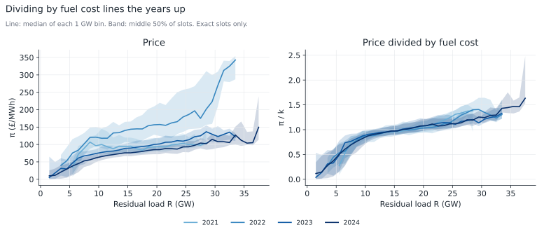

# fleet-sim

A simulator of UK home batteries scheduled against half-hourly electricity prices (Octopus Agile). It grows from one home to a fleet, to study how batteries that each do the best for their own home can together create new peaks in demand, and what coordinating them would trade away in savings to remove those peaks.

What follows is the argument so far, one question at a time. Each step was built on the one before, so each uses its own setup, and that setup is stated at the start of the step. A number in one step isn't directly comparable with a number in another. The commands that produced every result are at the end.

## Does one battery pay?

A home battery on a half-hourly tariff makes money in a simple way. Octopus Agile is a tariff whose price changes every half-hour, set the day before from the wholesale electricity market. A day has 48 of these half-hour slots, and the price is quoted in pence per kilowatt-hour (p/kWh), the unit on an electricity bill. Electricity is usually cheap in the middle of the night, when few people want it, and dear in the early evening, when everyone gets home and cooks. A battery that fills up in the cheap slots and runs the house through the dear ones pockets the difference.

The first step uses the smallest case that shows this: a single home in London (Agile region C) on one day, 20 October 2026. It has a 10 kWh battery that charges and discharges at up to 5 kW, more than a kettle and a half running flat out. The home uses a typical day's demand. The battery is scheduled two ways. The first is a rule: charge in the cheapest eight half-hours and discharge in the dearest eight. The second is an optimiser, which finds the cheapest possible schedule given the battery's size, speed and losses.

Without a battery, the day's bill was 604.05 p. The rule brought it down to 506.05 p and the optimiser to 480.78 p, a saving of £1.23 in one day. If every day were like that one, it would come to roughly £450 a year, though days differ. The striking thing is how little cleverness it takes. The crude rule kept 0.795 of the best possible saving: four-fifths of the money, for almost no thought.


*Top: the price, which jumps to about 50 p/kWh from 4 pm to 7 pm. Middle: how full the battery is. Bottom: what the home draws from the grid, without the battery (grey) and with it (blue). Look at the evening. The battery empties steadily from 3 pm, and the blue line sits at zero right through the dearest hours. The home buys nothing when electricity is dearest. It refills in short bursts in the cheaper slots: after midnight, before dawn, and late in the evening.*

One battery is a good deal for its owner. But a battery only knows the price, and every home on the street sees the same price.

## What if every home has one?

The simplest fleet is a hundred copies of that same home, each with the same battery, each scheduling itself against the same prices, every day of January 2026. Identical homes are unrealistic, and that is the point: they are the worst case, and they show the mechanism with nothing to blur it.

Every battery does the best thing for its own home, and each home saves a median of 97.16 p a day. But because they all see the same prices, they all choose the same half-hours. Without batteries the hundred homes peak at 150.00 kW, their evening demand, which is about half a kettle per home. With batteries, the busiest half-hour moves to whichever slot is cheapest that day, late in the evening or in the night, and the median daily peak becomes 560.00 kW, nearly four times as high. The highest, on 2 January, is 650.00 kW: 6.5 kW per home, as if every home had two kettles on at once. The fleet has created a peak that didn't exist before. That is the herd.


*What the hundred homes draw from the grid on 2 January, without batteries (grey) and with them (blue), with the price below. Through the dear early evening the batteries run every home, and the fleet draws nothing. The moment the price falls, at 20:30, all hundred batteries start refilling together, and the fleet draws 650 kW, more than four times its old evening peak. The same thing happens in the cheap slots just after midnight.*

## Isn't that just because the homes were identical?

Real homes differ in what they use and when, and in the batteries they buy. So the next step swaps the copies for real households. Each home's demand comes from the Low Carbon London trial, which recorded real London homes half-hour by half-hour. Each home gets a battery drawn from a catalogue of real products, from 5 kWh to 13.5 kWh, with slightly different efficiencies. The fleet is eight homes over 5–11 January 2026. It is kept small so that the experiment can be repeated many times.

Because the homes are drawn at random, any one fleet might be lucky or unlucky. So the whole experiment is drawn afresh thirty times. Each number below is the average of the thirty, with a 95% range in brackets: if the whole experiment were repeated with fresh draws, the average would very likely land in that range.

Variety helps. With a battery in every home, the varied fleet peaks 3.57 kW lower than eight identical copies of the average home (−4.34 to −2.80 kW). Different demands and different batteries pull the homes' schedules slightly apart.

It doesn't help much, though. Without batteries the eight homes peak at about 11 kW. A single battery among the eight is already enough to lift the peak above that, and with a battery in every home the peak is 26.19 kW higher. Batteries responding to the same prices line up, and that outweighs the variety between homes.


*The fleet's peak demand against the share of homes with a battery, which is called the penetration. Shaded bands are the 95% ranges. Grey is the same homes without batteries, flat at about 11 kW. Look at where blue leaves grey: almost at once, and then it climbs in a straight line. Each extra battery adds to the same peak.*

## Does it matter on the street?

A bigger peak only matters if something has to carry it. The first thing that has to carry it is the street's transformer. This is the local substation that steps the voltage down for a group of streets, and it can only carry so much before it overheats.

A transformer isn't sized for every home drawing its maximum at once, because ordinary homes don't all boil the kettle at the same moment. It is sized for the most a typical home draws once its neighbours' peaks are averaged in. Engineers call this ADMD, short for after diversity maximum demand, and take it as about 2 kW a home: less than one kettle each. Batteries break that assumption. A battery charging at 5 kW draws two and a half times a home's whole share, and the herd makes them all do it in the same half-hour.

To see whether that matters, this step needs more homes than eight, so that there are several transformers to share them. Fifty real homes are wired to four transformers. Each transformer is sized the way an engineer would size it: 2 kW a home, a power factor of 0.95, rounded up to a standard rating. The week is again 5–11 January 2026, drawn afresh thirty times.

Without batteries no transformer is overloaded. On average each runs at 0.43 of its rating at its busiest. Add batteries and they charge together in the same cheap half-hours. With batteries in a quarter of the homes, 15% of transformers are overloaded. With batteries in half, more than half are. With batteries in every home, every transformer is overloaded, running on average at 1.66 times its rating at its busiest.

Clustering makes it worse sooner. Batteries rarely spread evenly; one street adopts them before the next. When battery homes bunch on a few transformers, the energy those transformers carry above their rating rises from 3 kWh to 70 kWh at a quarter of homes. The full results are in [docs/results/milestone-4.md](docs/results/milestone-4.md).


*The share of the four transformers overloaded at some point in the week, against the share of homes with a battery, with battery homes spread evenly. The band is the 95% range. Look at how fast it rises: from almost none at 10% to nearly all of them by 75%.*

## Won't the market sort it out?

Everything so far has assumed the price stays put however many batteries chase it. One battery is far too small to move the electricity price. A million of them are not. Crowding into the cheapest half-hour should make it dearer, and a dearer half-hour should send some batteries elsewhere. Perhaps the market breaks up the herd by itself.

### How much does a crowd of batteries move the price?

To answer that, the simulator first needs to know how the wholesale price responds to load. The price in any half-hour is set mostly by how much demand is left once wind and solar have been used. This is called the residual load. More residual load means dearer power stations have to run, so the price rises. Batteries that all charge in the same half-hours add to the residual load there, and so raise the price.

The price is therefore fitted as a curve of residual load, using four years of market history, 2021–2024. One adjustment makes the history fit. Prices in 2022 sat far above other years because gas was expensive, not because demand was higher. So the main curve first divides the price by the fuel cost of a gas power station, and then the four years fall on one curve. That curve is exponential: it fits as well as any smooth shape, and it can never say that more load makes power cheaper. On 2025, a year it didn't see, it misses the price by 21.3 £/MWh on average (root-mean-square), against 19–36 £/MWh on the years it was fitted to.



*Left: the wholesale price against residual load, one line per year. 2022, the gas-crisis year, sits far above the rest. Right: the same prices divided by that year's fuel cost. Look at how the four years collapse onto one curve. Load explains the shape, and fuel cost explains the level.*

Where the fleet charges, one extra gigawatt of load raises the wholesale price by about £4–6/MWh, or 0.4–0.6 p/kWh, more in years when gas is dear. For scale, a gigawatt is a quarter of a million or so home batteries charging at once. The curve is steeper where the fleet charges than where it discharges. So a growing fleet should raise its buying price faster than it lowers its selling price.

How steeply the evening price responds is the least certain part. Two other curve shapes, a quadratic and a cubic, fit history two to three times worse. But they say the evening price is two to six times more sensitive to load, so they are kept as an upper bracket on how hard batteries could push the evening price around. Why the main curve was chosen is explained in [ADR-0004](docs/decisions/0004-price-curve-model.md), and the numbers are in [docs/results/price-curves.md](docs/results/price-curves.md).

### Does a responsive price break up the herd?

With a curve for how the price responds, the herd can be put back into the market it is herding in. This step uses the same fifty homes, four transformers and January week as the street step, because the street is where the question ends up. Each simulated battery is scaled up to stand for 0.5 to 4 million batteries in Great Britain. The experiment is drawn afresh ten times.

Each day is solved for its equilibrium: the point where the prices and the schedules agree. Every home's schedule is the best it can do at the prices the whole fleet creates, and those prices are the ones that schedule creates. No home could save more by changing its plan alone.

A responsive price spreads the herd over more of the night, but only partly. Picture the fleet filling the night like water poured into a tray with a bumpy bottom, where the bumps are the price in each half-hour. With the price fixed, every battery pours into the deepest dip, however full it gets. With a responsive price, each litre poured into a dip raises its floor, so the batteries fill the deepest dip until it is level with the next one, then fill both. At half a million batteries the change is small. At 4 million, each battery adds about half as much to the busiest half-hour as it would if prices ignored the fleet.

The total still grows. Four million batteries add about 8.8 GW at their peak, roughly a third of Britain's overnight demand that week. The evening doesn't move, because each battery is already running its whole home then.


*The extra load the fleet puts on the national grid over an average day, per million batteries. It is positive when batteries charge and negative when they run their homes. The grey dashed line is the herd when prices ignore it, with tall spikes at about 3:30 am and 10:30 pm. Look at the spikes. As the fleet grows, from light blue to dark, they shrink and spread into the half-hours either side. Then look at 4:30–6:30 pm, where every line sits in the same place.*

Spreading costs each home some of its saving, and how much depends on the price curve. With prices that ignore it, a battery saves its home 79 p a day, about £290 a year at that rate. That is less than the 97 p of the identical homes above, which had a different household, a different battery and the whole of January. Under the main price curve a home keeps 90% of that saving at 1 million batteries and 80% at 4 million. Under the two steeper curves, the upper bracket, it keeps only 42% and 25% at 4 million. Beyond about 1 million batteries, how sharply the evening price responds is the biggest uncertainty in the answer.


*Each battery home's daily saving against the number of batteries in Britain, under the main price curve (blue) and the two steeper ones. The shaded bands are the 95% ranges. Look at how far apart the lines end. At 4 million the main curve leaves a home about three times the saving the cubic does, and the bands are far apart.*

### Does it protect the street?

The street is a different matter, because a national price meets a local limit. The price fixes how much Britain charges in each half-hour, not which homes do it. Street A could charge at 1 am and street B at 3 am, or the other way round, or both at 2 am. If the national total in each half-hour is the same, so are the prices, and so is every home's bill.

So the simulation tries the two extremes. In the first, the solver picks who charges: the schedules come straight out of the calculation that finds the equilibrium. It happens to spread streets apart, and more batteries nationally seem to relieve local transformers. But nothing makes a home follow that schedule rather than another one that costs the same. In the second, each home takes the settled prices and plans alone, as a real battery's controller would. Neighbours look at the same prices, do the same arithmetic, and charge together again. Every transformer on a street full of batteries stays overloaded, however many batteries Britain has.


*The share of transformers overloaded against the share of homes with a battery, one line for each number of batteries in Britain. Left: the solver picks who charges. Right: each home plans alone. Top: battery homes spread evenly. Bottom: battery homes clustered. Look at the right-hand panels, where the lines lie on top of each other. National uptake makes no difference to the street.*

The full results, what depends on the price curve, and how far to trust the numbers are in [docs/results/milestone-4.6.md](docs/results/milestone-4.6.md).

## What comes next

A national price can't see a street. Protecting transformers needs a signal that can, which is the question for milestone 5: coordinating the batteries, and what that costs their owners.

## Reproduce these results

Set up and check the code:

```bash
uv sync
uv run pytest
uv run mypy --strict src
uv run ruff check
uv run ruff format
```

**One home.** This fetches the day's Agile prices, reads the home from `home.toml`, prints the three bills, and draws the day. The figure above was written with `--output docs/day`.

```bash
uv run fleet-sim run-home --date 2026-10-20 --region C
```

**A fleet of identical homes.** This prints the median, smallest and largest of each fleet measure across the month, and writes `frames.json` and two figures. The figure above was written with `--herding docs/herding --peaks docs/peaks`.

```bash
uv run fleet-sim run-fleet --homes 100 --start 2026-01-01 --end 2026-01-31 --region C
```

**Varied homes.** This reads the households from `.cache/lcl`, prints every measure with its range, and writes its frames and figures under `scenario-out/`. The penetration figure uses the six levels in `scenarios/penetration-sweep.toml`.

```bash
uv run fleet-sim run-scenario scenarios/diverse.toml
```

**Transformer overloads.**

```bash
uv run fleet-sim run-scenario scenarios/network-sweep.toml
```

**The price curve.** `compare` fits five curve shapes to three measures of the price on 2021–2024, scoring each on a year it didn't see. `finalise` refits the chosen curves, scores them once on 2025, and writes `calibration/price_curves.json`, which the market step reads.

```bash
uv run python scripts/fit_price_curves.py compare
uv run python scripts/fit_price_curves.py finalise
```

**The fleet in the market.**

```bash
uv run fleet-sim run-scenario scenarios/market-sweep.toml --release
```
