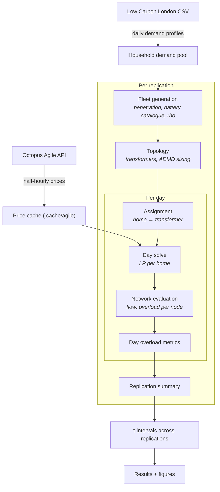
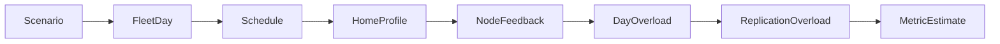

---
covers:
  - commands/network.py
  - commands/scenario.py
  - fleet/generate.py
  - fleet/topology.py
  - fleet/solve.py
  - fleet/network.py
  - fleet/overload.py
  - experiments/report.py
---

# Pipeline overview

The simulator runs in stages. Each stage takes typed data from the previous one and produces typed output for the next. This page shows the data flow visually and links to the detailed reference for each stage.

## Data flow

## Stages

**Fleet generation** ([Assumptions — Battery products](assumptions.md)) draws `n_homes` households from the demand pool. Each home is assigned a battery (or not) based on the penetration level. When clustering is enabled (ρ > 0), homes on the same transformer tend to adopt together. See `src/fleet_sim/fleet/generate.py`.

**Topology** ([Assumptions — Transformer sizing](assumptions.md)) builds a tree of transformers and assigns homes to them. Each transformer's limit is sized from ADMD, headroom, power factor, and the nearest standard rating. See `src/fleet_sim/fleet/topology.py`.

**Day solve** ([Formulation](formulation.md)) schedules each home independently against that day's prices. The home minimises its electricity bill by choosing when to charge and discharge, subject to battery constraints. This is a linear programme solved per home. See `src/fleet_sim/optimise/home.py`.

**Network evaluation** ([Formulation — Network](formulation.md)) sums each home's grid import up through the transformer tree, computing flow and overload at every node. A node's overload is how far its flow exceeds its limit. See `src/fleet_sim/fleet/network.py`.

**Replication summary** ([Experiments](experiments.md)) aggregates per-day metrics into per-replication numbers: share of transformers overloaded, mean and worst utilisation, total overload energy, and hidden-overload share. See `src/fleet_sim/fleet/overload.py`.

**t-intervals** ([Experiments](experiments.md)) compute 95% confidence intervals for each metric across independent replications, using Student's t-distribution. See `src/fleet_sim/experiments/report.py`.

## Data model

The key Pydantic types that flow between stages:

| Type | Module | Role |
| --- | --- | --- |
| `Scenario` | `models.scenario` | The TOML scenario parsed into a typed object |
| `FleetDay` | `models.fleet` | All homes for one day, with their batteries and demand |
| `Schedule` | `models.home` | One home's solved charge/discharge/import profile |
| `HomeProfile` | `models.network` | One home's grid import, as input to network evaluation |
| `NodeFeedback` | `models.network` | Flow and overload at one node over the day |
| `DayOverload` | `models.network` | Per-transformer overload metrics for one day |
| `ReplicationOverload` | `models.network` | Overload metrics aggregated across days |
| `MetricEstimate` | `models.results` | One metric with its confidence interval |
