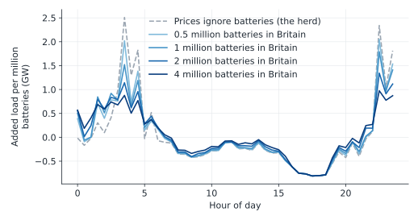
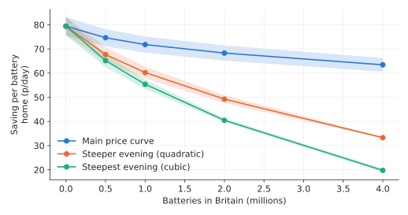
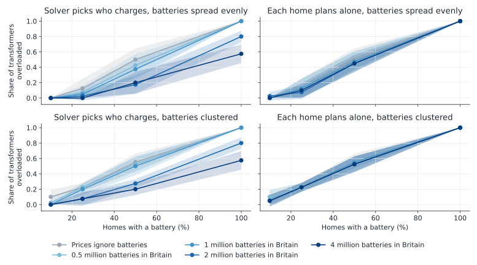

---
covers:
  - commands/market.py
  - fleet/market.py
  - fleet/price_inputs.py
  - viz/market.py
---

# The fleet in the loop: what happens when batteries move the price

A home battery on a half-hourly tariff earns its keep by buying electricity when it is cheap, usually in the middle of the night, and using it when it is dear, usually around 5 pm. One battery is far too small to change the price. A million of them are not.

Up to milestone 4, every battery in the simulation treated the price as fixed, as if the fleet were invisible to the market. That made batteries herd: they all found the same cheapest half-hour and piled into it together. This milestone lets the price respond. When the fleet crowds into a half-hour, that half-hour gets dearer, and the fleet has to decide again. The simulation looks for the point where it settles: every home's schedule is the best it can do at the prices the whole fleet creates.

Three questions follow:

1. Does a responsive price spread the herd out?
2. How much of each home's saving survives once there are millions of batteries?
3. Does it protect the transformers on local streets?

The short answers are: partly; most of it, if prices respond the way the main fitted curve says; and no.

## What was simulated

**The homes.** Fifty homes in the London region (region C), each with half-hourly demand taken from real households in the Low Carbon London trial. They are wired to four local transformers, the substations that feed a group of streets.

**The week.** 5–11 January 2026, a winter week.

**The batteries.** Each battery home gets a battery of 5 to 13.5 kWh, charging at 3.6 or 5 kW. For scale, a kettle draws about 3 kW, so a battery charging flat out is a kettle and a half running continuously. Homes don't sell power back to the grid. A battery can only run its own home.

**National uptake.** This is how many home batteries there are in all of Great Britain: 0, 0.5, 1, 2 or 4 million. It decides how much the fleet moves the national price. The simulation can't solve millions of homes, so it assumes the national fleet behaves like the simulated one: 4 million batteries draw 4 million times what an average simulated battery draws.

**The price curve.** How much does the price rise when the fleet adds load? That comes from a curve fitted to 2021–2024 market history, which links the wholesale price to how much demand is left after wind and solar, adjusted for gas and carbon costs (`docs/results/price-curves.md`). Three curve shapes fit history about equally well but disagree at the extremes. The **main curve** is used throughout. Two steeper ones, a **quadratic** and a **cubic**, are run as a check. They make the evening price two to six times more sensitive to load ([ADR-0004](../decisions/0004-price-curve-model.md)).

**Local uptake and clustering.** These decide what the transformers see. Local uptake is the share of the fifty homes with a battery: 10, 25, 50 or 100%. Clustering is whether battery homes are spread evenly across the four transformers or bunched together on a few of them, as happens when one street adopts batteries before its neighbours.

**Repeats and ranges.** The whole experiment is repeated ten times, each time drawing a fresh set of batteries and households. Every number below is the average of the ten. The 95% range in brackets is where that average would very likely land if the experiment were repeated with fresh draws. Each repeat with batteries moving the price is compared with the *same* homes, batteries and days with prices that ignore batteries. That pairing is why some of the ranges for changes are so narrow.

The first two questions use the case where every simulated home has a battery, which gives the most batteries to scale up to the national fleet.

## Does a responsive price spread the herd?

The way a fleet fills the night is like water poured into a tray with a bumpy bottom. The bumps are the price in each half-hour. With the price fixed, every battery pours into the deepest dip, however full it gets. With a responsive price, each litre poured into a dip raises its floor. Batteries keep filling the deepest dip until it is level with the next one, then fill both, and so on. More water means a flatter surface, spread over more of the night.

The figure shows the extra load the fleet puts on the national grid, across an average day of the week, for each million batteries. It is positive when batteries charge and negative when they run their homes.

The grey dashed line is the herd when prices ignore batteries. Two tall spikes stand out, at about 3:30 am and 10:30 pm. These are the half-hours the batteries crowd into. The blue lines show 0.5, 1, 2 and 4 million batteries in Britain, darker for more. As the fleet grows, the spikes shrink and the load spreads into the half-hours on either side.

Feedback barely changes behaviour at half a million batteries. On its busiest half-hour of the week, the fleet charges at about 95% of the rate it would with prices that ignore it. At 1 million it is 83%. At 2 and 4 million it is about half.

**The national peak still grows.** Spreading slows the growth but doesn't stop it. Eight times the batteries, from 0.5 to 4 million, add 4.4 times the peak, from 2.0 GW to 8.8 GW. Britain's demand overnight that week was about 28 GW, so 4 million batteries charging would add roughly a third to it.

**The evening doesn't change at all.** From 4:30 to 6:30 pm every line sits at the same place, about −0.8 GW per million batteries. Each battery is already supplying its whole home through the dearest hours. Because homes don't export, there is nothing more to give, and the price can't make them give it.

The figure averages the seven days. On any one night the herd's spike is taller and sharper, at whichever half-hour happens to be cheapest that night. Averaging lowers and widens it. The busiest half-hour of the week reaches 4.2 GW per million batteries with prices that ignore the fleet, against the 2.5 GW of the averaged curve.

## How much of each home's saving survives?

With prices that ignore it, a battery saves its home 79 p a day in this January week, about £290 a year at that rate. Once batteries move the price, they buy at a dearer night price and avoid a cheaper evening price, so the saving shrinks.

Under the main curve the loss is gentle. A home keeps 94% of its saving at half a million batteries, 90% at 1 million and 80% at 4 million: 63 p a day, about £230 a year.

Under the steeper curves the loss is not gentle. At 1 million batteries a home keeps 76% under the quadratic and 70% under the cubic. At 4 million it keeps 42% and 25%: 33 p and 20 p a day.

The shaded bands are the 95% ranges, and the three curves sit well outside each other's bands. **How much saving survives depends on the shape of the price curve more than on anything else in the simulation.** The curves part company from the first half-million batteries, and by 4 million the main curve leaves a home three times the saving the cubic does. Pinning down how steeply prices respond at the extremes would narrow the answer more than anything else here, including more repeats, more homes or more weeks.

The saving depends only on the fleet's total load in each half-hour, not on which homes supply it. That matters for the transformer question below.

## Where does the lost saving go?

A battery earns the gap between the price it buys at and the price it avoids. A growing fleet can close that gap from either end: by making the cheap half-hours dearer, or by making the dear half-hours cheaper. The price-curve fit predicted that the cheap end would move first (`docs/results/price-curves.md`). The night price is on the steep part of the curve when the fleet piles in. The evening price barely moves for the small amount each home can discharge.

Under the main curve, that is what happens. Take the herd's schedule with prices ignoring the fleet, and price it at the new prices. At 4 million batteries the half-hours where the herd charged become 1.97 p/kWh dearer. The half-hours where it discharged become only 0.52 p/kWh cheaper. Of the 16 p a day lost, about 14 p comes from dearer charging and 3 p from cheaper discharging, and the fleet wins back about 1 p by rescheduling. Four-fifths of the loss is at the cheap end.

Under the steeper curves the ordering reverses. Those curves make the evening price more sensitive, so the fleet's discharging pulls the evening price down hard. Under the cubic at 4 million batteries, 38 p a day is lost to cheaper discharging against 23 p to dearer charging. Under the quadratic the two ends are about equal.

One trap is worth pointing out. Average the prices the fleet actually pays and receives, and the gap *widens* with more batteries. At 4 million, the average buying price rises by 2 p/kWh but the average selling price rises by 3 p/kWh. This isn't a contradiction. The fleet trades less, charging 5.3 kWh a day per home instead of 7.1, and the trades it drops are its least profitable ones. It is like a shopkeeper who, when margins shrink, stops stocking the items that barely paid: the average margin goes up while the total profit goes down. Average prices show where the fleet chooses to trade, not how far the prices moved.

## Do national prices protect your street?

Each group of streets is fed by one transformer. It is sized for an ordinary evening, about 2 kW per home, because ordinary homes don't all boil the kettle at the same moment. Batteries do. When every battery on a street picks the same cheap half-hour, the transformer is overloaded. In milestone 4, with prices that ignored batteries, every transformer in the simulation was overloaded once every home had one.

Now let prices respond. When a million batteries all try to charge at 3:30 am, 3:30 am stops being the cheapest time, and some of them move. Does that rescue the street?

It depends on something the market doesn't decide: *which* batteries move. The price only sees the national total. Street A could charge at 1 am and street B at 3 am, or the other way round, or both at 2 am. If the national total in each half-hour is the same, the prices are the same, and so is every home's bill. The market settles how much is charged in each half-hour, not who charges it.

So the simulation tries two answers.

- **Solver picks who charges.** The solver that finds the settled point also hands each home a schedule. It happens to spread the streets out. But this is an accident of the method: it is one of many equally good splits, and nothing in the prices would make a home choose it.
- **Each home plans alone.** Each home takes the settled prices and works out its own cheapest schedule, as a real battery's controller would. Every home on a street sees the same prices and does the same arithmetic, so they choose the same half-hour again.

Each panel shows the share of transformers overloaded at some point in the week against the share of homes that have a battery. There is one line for each level of national uptake. The top row has battery homes spread evenly across transformers. The bottom row has them clustered.

On the left, when the solver picks, more batteries nationally seems to help. With 4 million batteries in Britain, the share of overloaded transformers on fully battery-equipped streets falls from all of them to 57%. But up to 1 million batteries every transformer is still overloaded, even here.

On the right, when each home plans alone, the lines lie on top of each other. National uptake makes no difference to the street. At full local uptake every transformer stays overloaded at every level of national uptake. Each battery home's busiest half-hour is back to 4.2 kW at 4 million batteries, the same as when prices ignored the fleet.

Clustering makes the point sharper. Where battery homes bunch on a few transformers, a quarter of homes with batteries is enough to overload about a fifth of transformers, and national uptake doesn't change it. Those homes see the same national price as everyone else and charge together under it.

Neither panel is a forecast. The left-hand one relies on homes following a schedule that nothing makes them follow. The right-hand one shows the pull towards herding when each home is left to itself. It isn't a settled state either: if every home really did re-plan, the national load would change and the prices would move again. Between them they bracket what transformers could see. **A national price can't see a street.** Protecting transformers needs a signal that can, which is the subject of milestone 5, coordination.

## Who pays when batteries move the price?

Take an ordinary home's half-hourly demand and price it at the new prices instead of the old ones. Under the main curve, its electricity costs a little more: 0.3 p a day at 1 million batteries, about £1 a year. The fleet raises night prices by more than it lowers evening prices, weighted by when homes use power.

Under the steeper curves the sign flips. Those curves let the fleet pull the evening price down so far that the same demand costs 5.7 p a day *less* at 1 million batteries under the quadratic, and 12 p a day less under the cubic: about £44 a year. So even the direction of the effect on everyone else depends on the price curve.

With every simulated home owning a battery, this is the price effect on household demand, not the bill of a particular home without one.

## How far to trust the numbers

**The price curve is approximated by straight pieces.** To keep the problem solvable as one linear program, each half-hour's price curve is replaced by 40 straight segments. The approximation is good for small fleets: under the main curve the price is off by about 0.05 p/kWh at half a million batteries and 0.38 p/kWh at 4 million. It is worse under the steep cubic curve, up to 3.3 p/kWh at 4 million.

**Is the settled point really settled?** After each day is solved, every home is offered the chance to re-plan alone at the resulting prices. If any home could save more than 1 p that day by doing so, the day is flagged. Under the main curve no day is flagged at half a million or 1 million batteries. At 2 and 4 million, about half and nearly all the fleet-days are flagged, the worst by 4.4 p. The flags come from the straight-piece approximation, not from the results. Re-running with 160 pieces instead of 40 clears almost all of them, 0 of 70 days flagged at 2 million and 2 of 70 at 4 million, and the answers barely move: 63.48 p a day saved instead of 63.43, and an 8.86 GW peak instead of 8.82. The steeper curves weren't re-run with 160 pieces. Their flags are larger, so treat their high-uptake numbers as rougher.

**Off the edge of the curve.** On one fleet-day, in one half-hour, the fleet pushed demand beyond the range the curve was fitted on. Everywhere else it stayed inside.

**No home charges and discharges at once.** The linear program allows that in principle. It never happened.

## Limits

This is one cold week in January 2026, one region and fifty homes, repeated ten times. The ranges measure how much the answer varies between fleets drawn from the same hundred households. They don't measure how it varies between weeks, seasons or regions. The national fleet is assumed to behave like the simulated one. Homes don't export, so the fleet can only lower evening prices by covering its own demand. A fleet allowed to export would push evening prices down harder. Coordinating batteries, and respecting transformer limits, are milestone 5.

## The numbers in full

Tables use these names: **M** is batteries in Britain. **ρ** is clustering: 0 is spread evenly, 0.8 is clustered. **Joint** is "solver picks who charges" and **re-planned** is "each home plans alone". The **headline point** is ρ = 0 with every simulated home owning a battery. Ranges are 95% t-intervals over 10 replications. A "change" is the paired difference from M = 0 on the same fleets, topology and days. The machine-readable results are in `docs/results/milestone-4.6.json`.

### Added load (headline point, main curve)

| M (million) | Peak added load (GW) | Per million batteries (GW) | Peak of the mean day (GW per million) |
| ---: | --- | ---: | ---: |
| 0 (historical) | – | 4.22 (4.11 to 4.33) | 2.51 at 03:30 |
| 0.5 | 1.99 (1.91 to 2.08) | 3.99 | 2.05 at 22:30 |
| 1 | 3.50 (3.41 to 3.60) | 3.50 | 1.79 at 22:30 |
| 2 | 4.65 (4.40 to 4.89) | 2.32 | 1.34 at 22:30 |
| 4 | 8.82 (8.33 to 9.31) | 2.21 | 0.97 at 22:30 |

"Per million batteries" at M = 0 is the largest net battery power over the week, 4.22 kW per battery home, scaled to a million homes.

### Saving per battery home (headline point, p/day)

The paired change from M = 0 is in the second line of each cell.

| M (million) | Exponential (main) | Signed quadratic | Cubic |
| ---: | --- | --- | --- |
| 0 | 79.41 (75.63 to 83.19) | 79.41 | 79.41 |
| 0.5 | 74.64 (71.13 to 78.15) −4.77 (−5.09 to −4.44) | 67.67 (64.68 to 70.67) −11.74 (−12.57 to −10.90) | 65.16 (62.44 to 67.88) −14.25 (−15.33 to −13.17) |
| 1 | 71.80 (68.47 to 75.13) −7.61 (−8.12 to −7.10) | 60.21 (57.76 to 62.67) −19.20 (−20.58 to −17.81) | 55.37 (53.40 to 57.34) −24.04 (−25.90 to −22.18) |
| 2 | 68.29 (65.14 to 71.44) −11.12 (−11.82 to −10.42) | 49.23 (47.58 to 50.88) −30.18 (−32.38 to −27.99) | 40.46 (39.69 to 41.24) −38.95 (−41.98 to −35.91) |
| 4 | 63.43 (60.59 to 66.26) −15.99 (−17.00 to −14.97) | 33.28 (32.94 to 33.61) −46.13 (−49.63 to −42.64) | 19.73 (19.07 to 20.39) −59.68 (−64.11 to −55.25) |

### Where the price moved (headline point, main curve, p/kWh)

The M = 0 schedules are held fixed and priced at each M (`scripts/decompose_market_saving.py`).

| M (million) | Where the herd charged | Where it discharged |
| ---: | --- | --- |
| 0.5 | +0.61 (0.60 to 0.63) | −0.07 (−0.08 to −0.07) |
| 1 | +0.98 (0.95 to 1.00) | −0.15 (−0.15 to −0.14) |
| 2 | +1.40 (1.37 to 1.44) | −0.28 (−0.29 to −0.26) |
| 4 | +1.97 (1.93 to 2.01) | −0.52 (−0.55 to −0.48) |

At 4 million the saving lost, 16.0 p/day, is 14.1 p from dearer charging plus 3.3 p from cheaper discharging, minus 1.4 p won back by rescheduling. Under the cubic, cheaper discharging against dearer charging is 13.3 against 11.6 p/day at 1 million and 38.4 against 23.0 at 4 million. Under the signed quadratic it is 24.1 against 24.1 at 4 million. Realised mean prices at 4 million, main curve: charging +2.04 (2.00 to 2.09) p/kWh, discharging +3.06 (2.94 to 3.18) p/kWh. Under the cubic, discharging −2.59 (−3.16 to −2.02) p/kWh. Energy charged per battery home: 7.1 kWh/day at M = 0, 5.3 at 4 million.

### Price change on household demand (headline point, p/day)

Main curve: +0.19 (0.12 to 0.25) at 0.5 million, +0.32 (0.20 to 0.44) at 1 million, +0.55 (0.12 to 0.98) at 4 million. At 1 million: −5.70 (−6.60 to −4.80) under the signed quadratic, −12.00 (−13.54 to −10.47) under the cubic. The measure averages over every simulated home's demand. It is close to the same at every local penetration, since demand is drawn the same way for every home (`docs/formulation.md`, Market measures).

### Transformers (local penetration 100%, main curve)

ρ = 0 and ρ = 0.8 coincide here, since every home has a battery.

| M (million) | Overloaded, joint | Overloaded, re-planned | Energy, joint (kWh) | Energy, re-planned (kWh) |
| ---: | --- | --- | --- | --- |
| 0 | 1.00 | 1.00 | 529.0 (464.8 to 593.2) | 529.0 |
| 0.5 | 1.00 | 1.00 | 229.1 (198.1 to 260.0) | 495.8 (437.9 to 553.7) |
| 1 | 1.00 | 1.00 | 126.0 (101.0 to 150.9) | 456.8 (402.3 to 511.3) |
| 2 | 0.80 (0.72 to 0.88) | 1.00 | 46.4 (30.0 to 62.9) | 428.2 (376.4 to 480.1) |
| 4 | 0.57 (0.45 to 0.70) | 1.00 | 22.1 (11.1 to 33.1) | 385.2 (337.3 to 433.1) |

Changes in overload energy from M = 0:
- Joint at 4 million: −506.9 kWh (−564.5 to −449.3).
- Re-planned: −72.2 kWh (−82.8 to −61.6) at 1 million and −143.8 kWh (−165.6 to −122.0) at 4 million.

Re-planned peak net power at 4 million is 4.19 kW (4.08 to 4.29) per battery home, against 4.22 at M = 0. Clustered (ρ = 0.8), re-planned share overloaded:
- 0.23 (0.17 to 0.28) at 25% local penetration.
- 0.55 (0.44 to 0.66) to 0.53 (0.42 to 0.63) at 50%, across M.

Joint at 25% and 4 million: 0.07 (−0.01 to 0.16).

### Diagnostics

Worst over the run, every point, model and day:
- **Linearisation error:** 3.30 p/kWh, cubic at 4 million. Main curve at the headline point: 0.05, 0.10, 0.20 and 0.38 p/kWh at 0.5, 1, 2 and 4 million.
- **(MODE) breaks:** none.
- **Equilibrium tolerance:** 1 p per home per day.
  - Largest re-plan saving: 37.67 p, cubic at 4 million.
  - 1,214 of 3,500 fleet-days flagged.
  - Main curve: none at 0.5 or 1 million; 264 of 560 at 2 million; 509 of 560 at 4 million, the largest 4.41 p. Under the robustness models, flags start at 0.5 million.
- **Re-planned load difference:** up to 18.9 GW, and 16.4 GW at the headline point at 4 million.
- **Out-of-range slots:** one, at 4 million and 10% local penetration.

**160 segments** (`scenarios/market-segments-160.toml`, headline point, 2 and 4 million):
- Linearisation error at 4 million: 0.38 → 0.09 p/kWh.
- Largest re-plan saving: 4.39 → 1.17 p.
- Flagged fleet-days: 46/70 → 0/70 at 2 million; 69/70 → 2/70 at 4 million.
- Saving at 4 million: 63.48 (60.64 to 66.32) p/day against 63.43.
- Peak added load at 4 million: 8.86 (8.42 to 9.31) GW against 8.82.

### How the run was made

`scenarios/market-sweep.toml`:
- Region C, 5–11 January 2026, master seed 1, 10 replications.
- Demand from the first 100 households in the Low Carbon London file.
- 40 segments per slot.
- 3,500 fleet-day solves in 409 s.

The 2026 price inputs were downloaded by the milestone-4.5 loaders: Agile rates, NESO demand, Elexon wind, and gas and carbon prices. GB overnight demand that week averaged about 28 GW, from NESO's national demand, 00:00–05:00.

On an empty cache, the first attempt stopped on 6 January with "no Agile rate for 48 of 48 slots". The cause was `load_agile_rates`, which had cached a partial January, fetched for 5 January only, under the whole month's key. Removing that file so the month was fetched whole let the run complete.

The decomposition and peak-per-home numbers are not in the sweep's output. `scripts/decompose_market_saving.py` re-solves the headline point on the same fleets and prints them.

With M = 0 the run reproduces milestone 4. At full local penetration it gives 529.0 kWh (464.8 to 593.2) of overload energy over 10 replications, against 548.8 kWh (517.0 to 580.5) over 30 in milestone 4.
